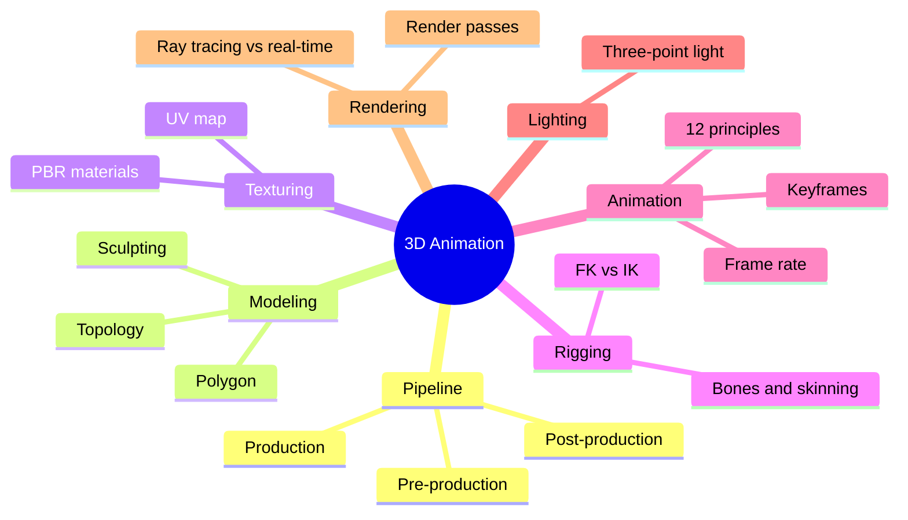

The course covers the 3D production pipeline and the principles that make movement believable.

### Outline

1. 3D pipeline
   - Pre-production: concept, storyboard, animatic
   - Production: modeling → UV unwrapping → texturing/shading → rigging → animation → lighting → rendering
   - Post-production: compositing, colour grading, editing
2. Modeling
   - Polygon modeling (vertices, edges, faces), subdivision surfaces, sculpting
   - Topology and edge flow; low-poly vs high-poly
3. Texturing and materials
   - UV map, texture maps (diffuse/albedo, normal, roughness), PBR materials
4. Rigging
   - Skeleton (bones/joints), skinning/weight painting, controllers
   - Forward kinematics (FK) vs inverse kinematics (IK)
5. Animation
   - Keyframes and interpolation, graph editor/curves
   - Disney's 12 principles: squash and stretch, anticipation, staging, straight ahead vs pose to pose, follow-through and overlapping action, slow in and slow out, arcs, secondary action, timing, exaggeration, solid drawing, appeal
   - Frame rate: 24 fps (film), 25/30 fps (video)
6. Lighting and camera
   - Three-point lighting: key, fill, back (rim) light
   - Virtual camera, depth of field
7. Rendering
   - Render engines (e.g. Cycles/Eevee in Blender, Arnold in Maya), ray tracing vs real-time
   - Render passes, output resolution, render time

### Mind map

### Key terms

| Term | Meaning |
| --- | --- |
| Topology | How polygons are arranged on a model; affects deformation |
| UV unwrapping | Flattening a 3D surface to 2D so a texture can be painted on it |
| Rigging | Building a skeleton and controls to animate a model |
| IK | Moving the end of a chain (hand) and the joints follow |
| Keyframe | A frame where you set a value; software interpolates between |
| Rendering | Calculating the final images from the 3D scene |

### Interview questions

1. Describe the 3D production pipeline.
   - Modeling → UV → texturing → rigging → animation → lighting → rendering → compositing.
2. Explain three of the 12 principles of animation.
   - Squash and stretch (weight), anticipation (prepares action), slow in and slow out (natural acceleration).
3. What is the difference between FK and IK?
   - FK rotates joint by joint from the root; IK positions the end and solves the chain. IK suits feet on the ground.
4. Why is good topology important?
   - Clean deformation in animation, easier UVs, efficient rendering.
5. What is three-point lighting?
   - Key (main), fill (softens shadows), back light (separates subject from background).
6. Which software did you use and what did you make?
   - Name the tool and your project (character, product, short scene).
