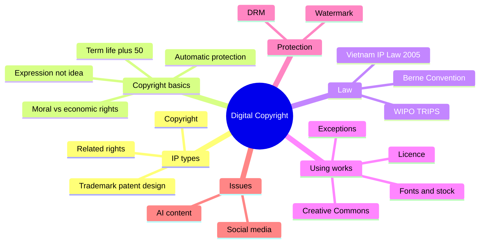

The course covers who owns creative work in the digital environment and how designers can use and protect it legally.

### Outline

1. Intellectual property (IP) types
   - Copyright: original creative works (images, music, video, software, designs)
   - Related rights: performers, producers of recordings, broadcasters
   - Industrial property: trademarks, patents, industrial designs
2. Copyright basics
   - Protects the expression, not the idea
   - Arises automatically when the work is created; registration is optional but helps as evidence
   - Moral rights (name, integrity of the work) vs economic rights (copy, distribute, adapt, publish)
   - Term: generally the author's life + 50 years under Vietnam's IP Law and the Berne minimum; some types (e.g. film, photography) are counted from publication
3. Legal framework
   - Vietnam: Law on Intellectual Property 2005, amended 2009, 2019 and 2022
   - International: Berne Convention, WIPO Copyright Treaty (1996), TRIPS Agreement
4. Using others' work
   - Licences and permission; work for hire / commissioned work
   - Exceptions: personal study, research, teaching, quotation with attribution (US "fair use" is a broader version)
   - Creative Commons licences: BY, SA, NC, ND, and CC0 (public domain)
   - Stock images, music and font licences (desktop vs web vs app licence)
5. Protecting digital work
   - DRM, watermarks, metadata, licensing terms
   - Plagiarism vs copyright infringement
6. Current issues
   - Social media reposting, memes, AI-generated content and ownership

### Mind map

### Key terms

| Term | Meaning |
| --- | --- |
| Copyright | Legal right of the creator over an original work |
| Public domain | Works no longer protected; free to use |
| Licence | Permission to use a work under conditions |
| CC BY-NC | Creative Commons: credit the author, no commercial use |
| DRM | Digital Rights Management: technical copy protection |
| Infringement | Using protected work without permission |

### Interview questions

1. What is the difference between copyright and trademark?
   - Copyright protects creative works automatically; trademark protects brand signs (logo, name) and normally needs registration.
2. Is an idea protected by copyright?
   - No, only its expression. Two people can make different posters from the same idea.
3. Explain Creative Commons licences.
   - Standard licences; BY = attribution, SA = share alike, NC = non-commercial, ND = no derivatives.
4. How do you use fonts and stock images legally in a project?
   - Check the licence type and scope (print, web, app, commercial), keep records, credit when required.
5. Who owns a design you create for a client?
   - Depends on the contract; usually rights are transferred or licensed to the client.
6. How did copyright affect your graduation project?
   - Name your asset sources (own work, licensed, free licence).
