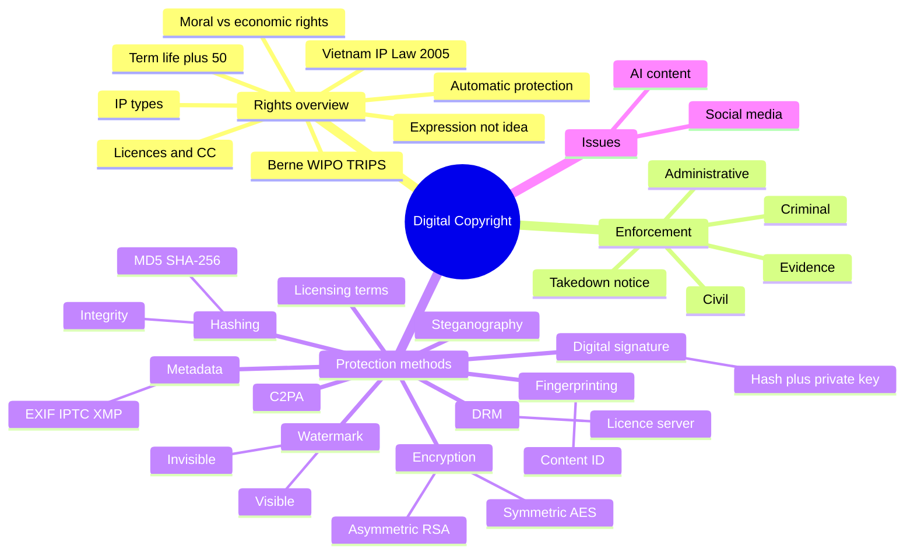

The course covers who owns creative work in the digital environment, how the law enforces that ownership, and which methods are used to protect digital files.

### Outline

1. Overview of rights
   - Intellectual property (IP) types
     - Copyright: original creative works (images, music, video, software, designs)
     - Related rights: performers, producers of recordings, broadcasters
     - Industrial property: trademarks, patents, industrial designs
   - Copyright basics
     - Protects the expression, not the idea
     - Arises automatically when the work is created; registration is optional but helps as evidence
     - Moral rights (name, integrity of the work) vs economic rights (copy, distribute, adapt, publish)
     - Term: generally the author's life + 50 years under Vietnam's IP Law and the Berne minimum; some types (e.g. film, photography) are counted from publication
   - Legal framework
     - Vietnam: Law on Intellectual Property 2005, amended 2009, 2019 and 2022
     - International: Berne Convention, WIPO Copyright Treaty (1996), TRIPS Agreement
   - Using others' work: licences, work for hire, exceptions (study, research, teaching, quotation with attribution), Creative Commons (BY, SA, NC, ND, CC0), font/stock licences (desktop vs web vs app)

2. How copyright is enforced
   - Owner's first steps: evidence (original files, dates, registration), then a warning letter
   - Platform route: takedown notice to the host or platform (e.g. DMCA-style notice and takedown)
   - Legal route in Vietnam: civil (court, damages, stop the act), administrative (inspectorates, fines), criminal (serious commercial-scale infringement)
   - Plagiarism (ethics) vs infringement (law)
   - Limits: hard to find copies online, cross-border cases, easy to copy and strip credit, so prevention matters

3. Methods to protect digital files (main topic)
   - 3.1 Hashing
   - 3.2 Encryption (symmetric, asymmetric)
   - 3.3 DRM
   - 3.4 Digital signature
   - 3.5 Metadata
   - 3.6 Watermarking (visible, invisible)
   - 3.7 Steganography
   - 3.8 Fingerprinting
   - 3.9 Content credentials (C2PA)
   - 3.10 Licensing terms
   - 3.11 Combining methods

4. Current issues
   - Social media reposting, memes, AI-generated content and ownership

---

### 3. Methods to protect digital files

**The big picture:** no single method stops copying. Each method does one job, so they are used in layers.

| Job | Methods |
| --- | --- |
| Prove the file is original and unchanged | Hashing, digital signature, C2PA |
| Say who owns it | Metadata, watermark, C2PA |
| Stop unauthorised use | Encryption, DRM, licensing terms |
| Find copies after release | Fingerprinting, invisible watermark |

#### 3.1 Hashing

**What it is:** a function that turns any file into a short, fixed-length string (the hash, or "digest"). Think of it as the file's fingerprint.

**Key properties**
- Same file always gives the same hash.
- One-way: you cannot rebuild the file from the hash.
- Tiny change gives a completely different hash (change one pixel and the whole string changes).
- Fixed length: a 1 KB file and a 10 GB video both give the same length of hash.

**Common algorithms**

| Algorithm | Output | Status |
| --- | --- | --- |
| MD5 | 128-bit | Fast but broken (collisions can be forced); fine for quick file checks, not for proof |
| SHA-1 | 160-bit | Also broken; being phased out |
| SHA-256 | 256-bit (64 hex characters) | Current standard |

**How it protects a creator (simple steps)**
1. Finish the file (e.g. `poster.png`).
2. Compute its hash (e.g. SHA-256).
3. Store the hash with a date: email it to yourself, a notary, or a timestamping service.
4. In a dispute, hash the file again. If it matches the stored hash, the file existed on that date and has not been changed.

**What it proves:** integrity (not changed) and, with a dated record, existence at a point in time.

**Limits**
- Does not say who made the file.
- Exact match only: resizing, cropping or re-saving as JPEG changes the hash, so it cannot catch edited copies (fingerprinting does that).
- Hashing is not encryption: nothing is hidden or locked.

**Also used for:** checking a download is not corrupted, and as the first step of digital signatures.

#### 3.2 Encryption

**What it is:** scrambling a file with an algorithm and a key so it turns into unreadable ciphertext. Only someone with the right key can turn it back (decrypt). Unlike a hash, encryption is reversible.

**Two types**

| | Symmetric | Asymmetric |
| --- | --- | --- |
| Keys | One shared secret key | Key pair: public key + private key |
| Rule | Same key encrypts and decrypts | Public key encrypts, private key decrypts (and the reverse for signatures) |
| Speed | Fast, good for large files | Slow, good for small data |
| Examples | AES (AES-128, AES-256) | RSA, ECC |
| Weak point | How to share the key safely | Slow on big files |

**Why both are used together:** the file is encrypted with fast AES; the AES key is then protected with asymmetric encryption so it can be sent safely.

**Simple steps (protecting a paid file)**
1. Encrypt the file with a random AES key.
2. Distribute the encrypted file freely (it is useless without the key).
3. Give the key only to people who have a licence or have paid.
4. Their software decrypts and opens the file.

**Where it is used:** password-protected PDF or ZIP, encrypted drives, HTTPS when downloading files, and streaming and e-book DRM.

**Limits**
- Once decrypted and shown on screen or played through speakers, it can be recorded (screenshot, screen capture).
- If the key leaks, protection is gone.
- Strong encryption makes the file harder to use for honest customers too.

#### 3.3 DRM (Digital Rights Management)

**What it is:** encryption plus a licence system. It controls who can open a file, on which device, for how long, and what they can do (copy, print, download).

**How it works (typical streaming or e-book flow)**
1. The publisher encrypts the content with a content key.
2. The user buys or rents and requests access.
3. A licence server checks the account and licence rules.
4. The server sends the decryption key to an approved player or app.
5. The player decrypts and plays inside a protected environment; the key is not given to the user.

**Examples:** Widevine (Google), FairPlay (Apple), PlayReady (Microsoft) for video and music; Kindle for e-books; Adobe for PDFs and Creative Cloud licences.

**Pros:** strong control, enables rental, subscription and offline expiry.
**Cons:** inconvenient for users, locks content to platforms, can be cracked, and blocks some legal uses (e.g. quotation, backup).

#### 3.4 Digital signature

**What it is:** proof of who created a file and that it has not been changed since signing. It combines a hash and asymmetric keys.

**How it works**
1. Signer hashes the file.
2. Signer encrypts the hash with their **private key**. This is the signature.
3. File + signature + signer's certificate (with the **public key**) are sent.
4. Receiver hashes the file themselves, and decrypts the signature with the public key.
5. If both hashes match, the file is authentic and unchanged.

**Proves:** authorship (identity), integrity, and non-repudiation (the signer cannot deny signing).
**Limits:** needs a trusted certificate authority; any edit breaks the signature; it does not stop copying.
**Examples:** signed PDFs, signed software, code signing, C2PA manifests.

**Hash vs signature:** a hash shows the file is unchanged. A signature shows it is unchanged and who made it.

#### 3.5 Metadata

**What it is:** information stored inside the file about the file.

| Standard | Typical content |
| --- | --- |
| EXIF | Camera, date, settings, GPS location |
| IPTC | Creator, copyright notice, usage terms, contact |
| XMP | Adobe's flexible format; holds IPTC-style rights info and edit history |

**How to use:** fill in creator name, copyright line and licence URL in Photoshop, Lightroom or Bridge before export.

**Pros:** easy, free, helps honest users find the owner (orphan-works problem).
**Cons:** easy to strip. Social platforms often remove it on upload, and a screenshot has none. So metadata is a label, not a lock.

#### 3.6 Watermarking

**What it is:** adding a mark to the content itself to show ownership.

| | Visible watermark | Invisible watermark |
| --- | --- | --- |
| Look | Logo or text on the image/video | Hidden in the data, not seen or heard |
| Purpose | Deter theft, credit the owner | Prove ownership, trace leaks |
| Weakness | Can be cropped, blurred or removed (AI tools too) | Can be damaged by heavy editing |

**How invisible watermarks work**
- Spatial domain: change tiny pixel values (e.g. least significant bits). Simple but fragile.
- Frequency domain: embed in frequency coefficients (DCT, DWT). More robust against compression, resizing and cropping.
- Trade-off: stronger watermark = more robust but more visible. Good ones balance imperceptibility, robustness and capacity.

**Forensic watermark:** a different hidden mark for each recipient (e.g. each client or screener copy), so a leak can be traced back to the person who received that copy.

**Practical tip for designers:** put visible watermarks across the subject, not just in a corner; share low-resolution previews.

#### 3.7 Steganography

**What it is:** hiding a message or data inside another file (image, audio, video) so nobody knows it is there.

**Example (LSB):** change the last bit of each pixel's colour value to carry hidden bits. The image looks identical.

**Compare**

| | Encryption | Steganography | Watermark |
| --- | --- | --- | --- |
| Hides | The content (readable only with key) | The existence of the data | Ownership info |
| Anyone can see something is there? | Yes | No | Visible: yes; invisible: no |
| Main goal | Secrecy | Covert communication | Ownership and tracing |

Steganography is the technique behind invisible watermarks, but a watermark must survive editing while plain steganography only needs to stay hidden.

#### 3.8 Fingerprinting (content recognition)

**What it is:** identifying content by its own features, without adding anything to the file.

**How it works (e.g. YouTube Content ID)**
1. The owner uploads the original as a reference.
2. The system extracts features (audio peaks, visual patterns) and stores them as a fingerprint in a database.
3. Every new upload is compared with the database.
4. On a match, the owner picks an action: block, monetise, or just track.

**Why it beats hashing:** it still matches after cropping, re-encoding, pitch change or added noise (a hash would not). Related idea: perceptual hashing.
**Limits:** needs a big database and a platform to run it; false matches happen; heavy changes can evade it.

#### 3.9 Content credentials (C2PA)

**What it is:** an open standard (C2PA, Coalition for Content Provenance and Authenticity) that attaches a signed record of a file's history, shown as a "CR" Content Credentials icon.

**What the record contains:** who created it, which tool or camera, edits made, whether AI was used.

**How it works**
1. Camera or software creates a manifest (the claims).
2. The manifest is bound to the file by a hash.
3. It is signed with a digital certificate.
4. Anyone can verify: if the file or manifest changed, the check fails.

**Why it matters now:** helps tell real, edited and AI-generated content apart. Supported by Adobe, camera makers, news and AI companies.
**Limits:** can be stripped when platforms remove metadata (so it is often paired with watermarking); shows provenance, not legal ownership.

#### 3.10 Licensing terms

Technical tools control access; the licence defines what is allowed: use (personal, commercial), scope (web, print, app), duration, territory, whether credit is required, whether edits and resale are allowed. Display it in metadata, on the page, or in the contract.

#### 3.11 Combining methods

Example workflow for a designer publishing artwork:
1. Hash the final file and store the hash with the date (proof of original).
2. Embed metadata with creator and licence (identify).
3. Publish a low-resolution version with a watermark (deter, trace).
4. Sell the full file under a clear licence, with C2PA credentials or a signature (prove origin).
5. Use reverse image search or fingerprinting tools to find copies (detect), then use the enforcement steps in section 2.

---

### Mind map

### Key terms

| Term | Meaning |
| --- | --- |
| Copyright | Legal right of the creator over an original work |
| Public domain | Works no longer protected; free to use |
| Licence | Permission to use a work under conditions |
| CC BY-NC | Creative Commons: credit the author, no commercial use |
| Infringement | Using protected work without permission |
| Takedown notice | Request to a platform to remove infringing content |
| Hash | Fixed-length, one-way fingerprint of a file; changes if the file changes |
| SHA-256 | Current standard hash algorithm (256-bit) |
| Encryption | Scrambling data with a key so only key holders can read it |
| Ciphertext | The scrambled, unreadable result of encryption |
| Symmetric encryption | One shared key encrypts and decrypts (AES) |
| Asymmetric encryption | Public/private key pair (RSA) |
| DRM | Encryption plus licence rules controlling access and use |
| Digital signature | Hash signed with a private key; proves author and integrity |
| Metadata | Author and rights info embedded in a file (EXIF, IPTC, XMP) |
| Watermark | Visible or hidden mark identifying the owner |
| Steganography | Hiding data inside another file |
| Fingerprinting | Recognising content by its features, even after edits (Content ID) |
| C2PA | Standard for signed content credentials and edit history |

### Interview questions

1. What is the difference between copyright and trademark?
   - Copyright protects creative works automatically; trademark protects brand signs (logo, name) and normally needs registration.
2. Is an idea protected by copyright?
   - No, only its expression. Two people can make different posters from the same idea.
3. How is copyright enforced if someone steals your design?
   - Keep evidence, send a warning or takedown notice to the platform, then civil, administrative or criminal action depending on the case.
4. What is hashing and how can it protect your work?
   - A hash is a one-way fingerprint of a file. Store the hash with a date; later, if the file gives the same hash, it is unchanged and existed at that time.
5. Why is SHA-256 preferred over MD5?
   - MD5 has known collisions, so two different files can share a hash. SHA-256 is still considered secure.
6. What is the difference between hashing and encryption?
   - Hashing is one-way and has no key; it checks integrity. Encryption is reversible with a key; it hides content.
7. Symmetric vs asymmetric encryption?
   - Symmetric uses one shared key (fast, e.g. AES); asymmetric uses a public/private pair (slower, e.g. RSA). They are often combined.
8. How does DRM work?
   - Content is encrypted; a licence server gives the key only to authorised players, under rules such as device, time and copies.
9. What is the difference between a hash and a digital signature?
   - A hash shows the file is unchanged; a signature, made with the private key, also proves who made it.
10. Visible vs invisible watermark?
    - Visible deters and credits; invisible survives cropping and compression and helps trace leaks.
11. Why is metadata not enough to protect a file?
    - It is easy to strip, for example when uploading to social media.
12. How do platforms like YouTube detect reuploads?
    - Fingerprinting (Content ID) matches content even after edits.
13. What is C2PA and why does it matter now?
    - Signed edit history attached to a file; helps show whether an image is original, edited or AI-generated.
14. How would you protect your design files before publishing online?
    - Layer methods: hash and date the original, embed metadata, watermark a low-resolution preview, state the licence.
15. Who owns a design you create for a client?
    - Depends on the contract; usually rights are transferred or licensed to the client.
16. How did copyright affect your graduation project?
    - Name your asset sources (own work, licensed, free licence).
