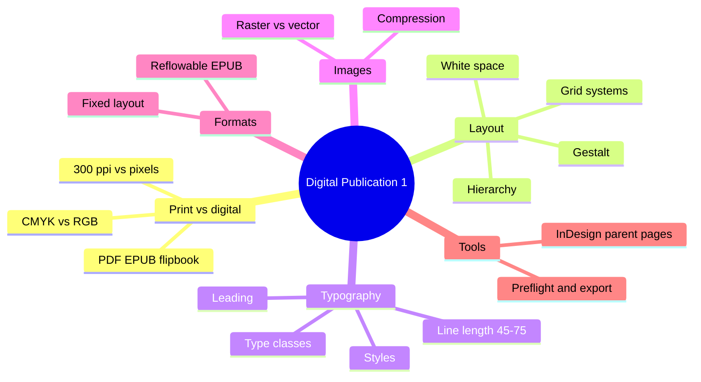

The course covers layout and typography for publications made for screens: e-books, e-magazines, digital catalogues and reports.

### Outline

1. Print vs digital publication
   - Colour: CMYK for print, RGB for screen
   - Resolution: 300 ppi for print; for screen, pixel dimensions matter more than ppi
   - Output: PDF, interactive PDF, EPUB, online flipbook, HTML
2. Layout principles
   - Grid systems: manuscript, column, modular, baseline grid
   - Margins, gutters, white space, rule of thirds
   - Visual hierarchy: size, weight, colour, position
   - Gestalt: proximity, similarity, alignment, continuity
3. Typography for reading
   - Typeface classes: serif, sans-serif, display, monospace
   - Type hierarchy: headline, subhead, body, caption
   - Readability: 45–75 characters per line, leading about 120–145% of font size, alignment
   - Paragraph and character styles for consistency
4. Images and colour
   - Raster vs vector; JPEG, PNG, SVG
   - Image compression and file size
   - Colour palette, contrast, brand consistency
5. Digital formats
   - Fixed layout: page looks exactly as designed (magazines, comics)
   - Reflowable layout (EPUB): text adapts to screen size and user settings (novels)
6. Workflow and tools
   - Adobe InDesign: master/parent pages, styles, linked images, export
   - Pre-flight check before export

### Mind map

### Key terms

| Term | Meaning |
| --- | --- |
| Grid | Invisible structure of columns and rows that aligns content |
| Gutter | Space between columns |
| Leading | Vertical space between lines of text |
| Kerning / tracking | Space between two letters / across a word or line |
| Master (parent) page | Template page whose elements repeat on many pages |
| Reflowable | Content that reflows to fit any screen |
| Preflight | Checking fonts, images and colour before export |

### Interview questions

1. What is the difference between designing for print and for digital?
   - Colour mode, resolution, interactivity, screen sizes, file size.
2. Why do designers use a grid?
   - Consistency, alignment, faster layout decisions, clear hierarchy. Example: a 12-column grid for a magazine spread.
3. What is the difference between fixed and reflowable layout? When do you use each?
   - Fixed for visual-heavy magazines; reflowable for text-heavy books read on many devices.
4. How do you make long text readable on screen?
   - Line length 45–75 characters, enough leading, contrast, clear hierarchy, sans-serif or screen-optimised serif.
5. What are paragraph styles and why are they useful?
   - Saved formatting that keeps text consistent and allows global changes.
6. Tell me about a publication you designed in this course.
   - Topic, format, grid, typefaces, one problem you solved.
