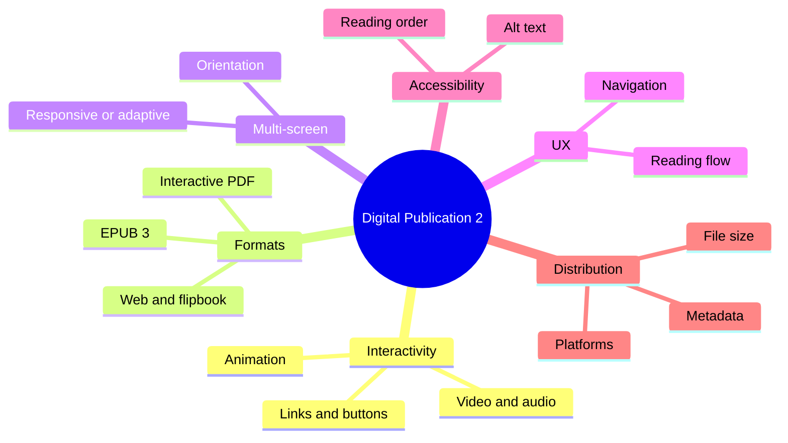

The course builds on Digital Publication Design 1 and adds interactivity, motion and multi-device publishing.

### Outline

1. Interactive publications
   - Hyperlinks, buttons, navigation menus, table of contents links
   - Embedded video and audio, slideshows, image galleries
   - Animation and transitions on pages
2. Formats and their strengths
   - Interactive PDF: keeps layout, limited multimedia support
   - EPUB 3 (HTML5 + CSS + JavaScript inside): supports audio, video, fixed or reflowable layout
   - Online publishing: flipbooks, web-based magazines, HTML
   - App-style publications for tablets
3. Designing for many screens
   - Portrait vs landscape, tablet vs phone
   - Responsive or adaptive layouts, liquid layout
4. Interaction and navigation design
   - Consistent navigation, clear clickable areas, feedback
   - Reading flow and user experience of long content
5. Accessibility
   - Alt text for images, logical reading order, contrast, tagged PDFs
6. Production and distribution
   - Optimising file size, testing on devices, metadata (title, author, ISBN)
   - Platforms: Apple Books, Google Play Books, web platforms

### Mind map

### Key terms

| Term | Meaning |
| --- | --- |
| EPUB 3 | Open e-book standard built on HTML5 and CSS |
| Interactive PDF | PDF with links, buttons and media |
| Alt text | Text description of an image for screen readers |
| Adaptive layout | Separate fixed layouts for specific screen sizes |
| Responsive layout | One fluid layout that adjusts to any screen |
| Metadata | Information about the publication itself |

### Interview questions

1. What is the difference between Digital Publication Design 1 and 2?
   - From static layout to interactive, multimedia, multi-device publications.
2. Compare interactive PDF and EPUB 3.
   - PDF keeps exact layout but is weak on small screens; EPUB 3 is HTML-based, supports media and reflow.
3. How do you design navigation for an interactive magazine?
   - Clear table of contents, consistent buttons, feedback, way back to the start.
4. How do you make a digital publication accessible?
   - Alt text, reading order, contrast, real text instead of text in images.
5. Describe the interactive publication you made.
   - Topic, format, interactive elements, how you tested it.
