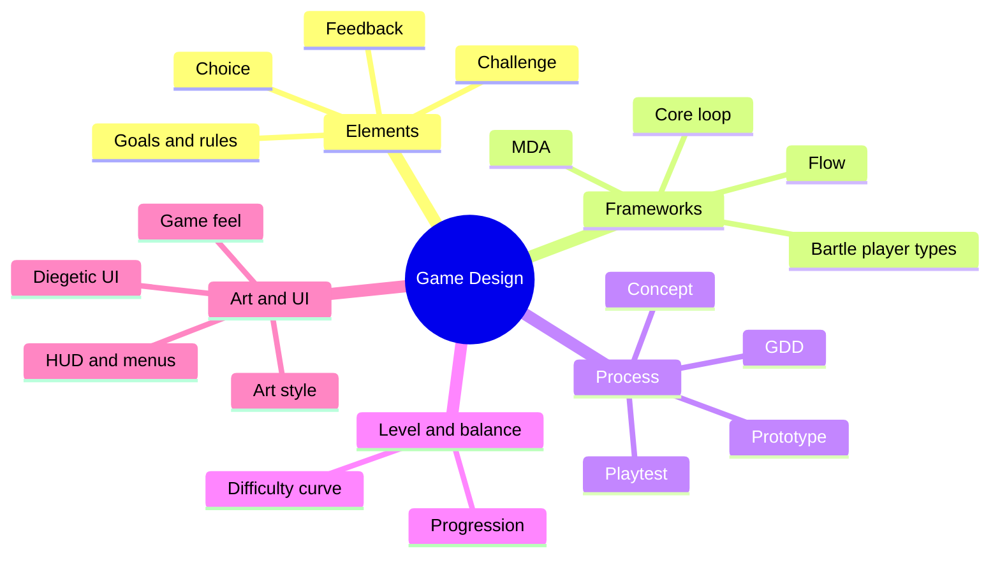

The course covers how games create experience through rules, goals, feedback and visual design.

### Outline

1. What is a game
   - Elements: goals, rules, conflict/challenge, feedback, player choice
   - Genres: action, puzzle, RPG, strategy, casual, serious games
2. Frameworks
   - MDA (Hunicke, LeBlanc, Zubek, 2004): Mechanics → Dynamics → Aesthetics. Designers build from mechanics; players feel from aesthetics.
   - Core loop: the action the player repeats (e.g. fight → collect → upgrade)
   - Flow theory (Csikszentmihalyi): challenge must match skill, otherwise boredom or anxiety
   - Player types (Bartle): achievers, explorers, socialisers, killers
3. Design process
   - Concept and pitch → Game Design Document (GDD) → paper prototype → digital prototype → playtest → iterate
4. Level and balance design
   - Difficulty curve, pacing, tutorial through play
   - Balance: fair and meaningful choices, rewards and progression
5. Game art and UI
   - Art style, characters, environment, sprites
   - HUD (health, score, map), menus, icons
   - Diegetic UI (inside the game world) vs non-diegetic UI (overlay)
   - Game feel / juice: feedback through animation, sound, screen shake
6. Tools
   - Engines: Unity, Unreal, Godot; art tools: Photoshop, Illustrator, Blender

### Mind map

### Key terms

| Term | Meaning |
| --- | --- |
| Mechanics | The rules and actions available to the player |
| Dynamics | Behaviour that emerges when players use the mechanics |
| Aesthetics | The emotional response of the player (fun, tension, discovery) |
| Core loop | The main repeated cycle of play |
| GDD | Game Design Document describing the full game |
| Playtest | Observing real players to find problems |
| HUD | Head-up display: on-screen game information |

### Interview questions

1. Explain the MDA framework.
   - Mechanics create dynamics, which create aesthetics. Example: a time limit (mechanic) causes rushing (dynamic), which creates tension (aesthetic).
2. What is a core loop? Give an example.
   - Candy Crush: match → clear level → earn reward → next level.
3. How do you keep players in flow?
   - Increase difficulty gradually, clear goals, immediate feedback.
4. How is game UI different from app UI?
   - Must not break immersion, must be readable during fast action; diegetic options.
5. What goes into a GDD?
   - Concept, target players, mechanics, levels, characters, art style, UI, controls, monetisation.
6. Describe the game you designed in this course.
   - Genre, core loop, your role (art, UI, level), what playtesting changed.
