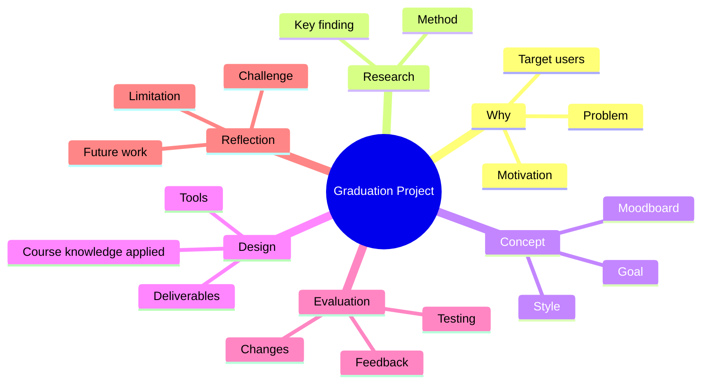
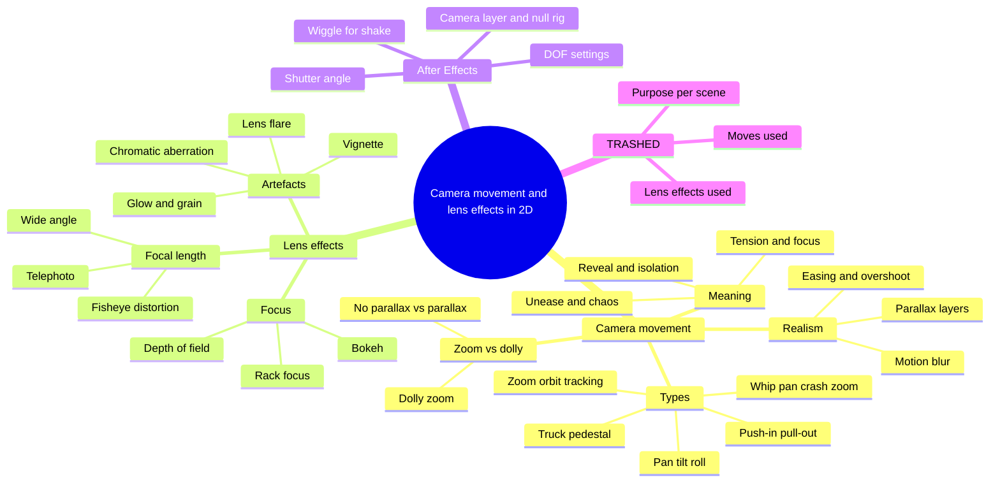

Expect the first and longest questions here. Prepare a 2-minute pitch, then be ready for "why" and "how" on every step.

### 2-minute pitch

> "My graduation project researched camera movement and lens effects in 2D animation. A 2D scene has no real camera, so both the movement and the look of a lens have to be simulated. I studied camera movements such as \[push-in, pan, truck, shake\] and lens effects such as \[depth of field, rack focus, lens flare, vignette\], focusing on what each one communicates to the viewer and how to create it convincingly. Then I applied them in a motion graphic short film called TRASHED, about \[theme / message\]. I made it in \[After Effects / other tools\]. For example, in \[scene\] I used \[movement or effect\] to \[purpose\]. The council gave the project an A. If I continued, I would \[next step\]."

### Fill in your project facts

| Part | Your answer |
| --- | --- |
| Title (Vietnamese + English) | Camera movement and lens effects in 2D animation \[exact official title\] |
| Product type | Motion graphic short film |
| Final output | TRASHED, on [Behance](https://www.behance.net/gallery/189270055/TRASHED-Motion-graphic-short-film) |
| Story and message of TRASHED | \[ \] |
| Length, resolution, frame rate | \[ \] |
| Target audience | \[ \] |
| Why camera movement and lens effects (motivation) | \[ \] |
| Research method and sources | \[ \] |
| Camera movements used, and in which scenes | \[ \] |
| Lens effects used, and in which scenes | \[ \] |
| Visual style: colours, typefaces, references | \[ \] |
| Tools | \[ \] |
| Feedback and what changed | \[ \] |
| Supervisor | \[ \] |
| Biggest challenge and solution | \[ \] |
| Limitations and future work | \[ \] |
| Courses applied | Storyboarding (shots, camera moves), 3D Animation Design (virtual camera, lighting), Digital Copyright (music, fonts, assets), Research Methodology |

### Process mind map

Connect the project to at least three courses. For example: Mobile Application Design for the UX process, Digital Copyright for asset sources, Research Methodology for the user research, History of Fine Arts and Design for your style references.

## Camera movement and lens effects in 2D: the theory behind TRASHED

The project focuses on two things: **camera movement** (how the virtual camera moves and what each move means) and **lens effects** (how a real lens looks and how to fake it on flat layers). Expect the examiner to test both before asking about the film.

### Outline

1. Why a virtual camera matters in 2D
   - No physical camera: movement and the lens look are simulated on layers
   - Purpose: guide attention, set rhythm, build emotion, connect scenes
   - Every move and effect should be motivated by story, emotion or information
2. Camera movement: the types
   - Pan (turn left/right), tilt (turn up/down), roll (rotate the horizon)
   - Truck (move sideways), pedestal/crane (move up/down), push-in and pull-out (dolly)
   - Zoom, orbit/arc, tracking (follow) shot
   - Speed variants: slow drift, whip pan, crash zoom
3. Camera movement: zoom vs dolly
   - Zoom changes focal length: the image scales flatly, with no parallax
   - Dolly changes camera position: layers shift against each other (parallax)
   - Dolly zoom combines both: subject stays the same size while the background stretches (Hitchcock, *Vertigo*, 1958)
4. Camera movement: what it communicates
   - Push-in: tension, focus, inner emotion · pull-out: reveal, isolation, ending
   - Pan or truck: follow action, reveal space · tilt: show height or power
   - Roll or Dutch angle: unease · shake: impact, chaos, handheld realism
   - Static camera: calm, observation, contrast with movement
5. Camera movement: making it feel real
   - Easing (slow in, slow out), small overshoot and settle, subtle drift
   - Parallax layers (foreground, midground, background) so moves read as 3D
   - Motion blur on fast moves; keep screen direction consistent (180-degree rule)
6. Lens effects: focal length look
   - Wide angle (short focal length): exaggerated depth, distortion near edges
   - Telephoto (long focal length): compressed space, flatter look
   - Fisheye or barrel distortion: straight lines bend outward
7. Lens effects: focus
   - Depth of field: shallow isolates the subject, deep keeps everything sharp
   - Rack focus (focus pull): shifts attention from one subject to another
   - Bokeh: the shape and softness of out-of-focus highlights
8. Lens effects: optical artefacts
   - Lens flare (spherical ghosts or anamorphic streaks), light leaks
   - Vignette, chromatic aberration, glow/bloom, film grain
   - They add realism and mood, but overuse looks cheap and distracts
9. Building them in After Effects
   - 3D layers + camera layer (one-node or two-node); a null object as the camera rig
   - Camera options: zoom/focal length, depth of field (focus distance, aperture, blur level)
   - Motion blur switch and shutter angle; `wiggle()` expression for camera shake
   - Effects such as Camera Lens Blur, Optics Compensation (distortion) and Lens Flare
   - Plan moves in the storyboard and animatic first
10. Origin worth knowing
    - Disney's multiplane camera, first used in *The Old Mill* (1937), simulated camera depth through painted glass layers

### Mind map

### Key terms

| Term | Meaning |
| --- | --- |
| Parallax | Layers at different depths move at different speeds |
| Dolly vs zoom | Moving the camera vs changing the focal length |
| Focal length | Lens length; short = wide view and deep space, long = narrow view and compressed space |
| Depth of field | The range of distance that looks sharp |
| Rack focus | Shifting focus from one subject to another during a shot |
| Bokeh | The quality of out-of-focus blur and highlights |
| Shutter angle | Controls how long motion blur trails are |
| Chromatic aberration | Red/blue colour fringes at high-contrast edges |
| Vignette | Darkened frame edges that pull the eye to the centre |
| Lens flare | Streaks or ghosts caused by bright light entering the lens |
| Null object | Invisible parent layer used to rig the camera |
| Easing | Gradual acceleration and deceleration of a move |

### Interview questions on the theory

1. Why did you focus on camera movement and lens effects?
   - &#91;Your motivation\]. Link to the problem: flat 2D motion graphics can feel static and less cinematic.
2. Which camera movements did you study, and what does each communicate?
   - Push-in = tension or focus, pull-out = reveal, pan/truck = follow or reveal space, shake = impact.
3. What is the difference between a zoom and a dolly in 2D?
   - A zoom scales the whole image flatly; a dolly moves the camera through layers, so parallax changes.
4. How do you make a 2D camera move feel real?
   - Easing, parallax layers, motion blur, a small overshoot or drift.
5. How does focal length change the look of a shot?
   - Wide = deep space and distortion; telephoto = compressed, flatter space.
6. What is rack focus, and where did you use it in TRASHED?
   - Shifting focus between subjects to move attention. \[Scene\].
7. Which lens effects did you use, and why?
   - &#91;Flare / vignette / chromatic aberration / DOF\] to add realism, mood or focus. \[Scene\].
8. How did you build these effects in your software?
   - &#91;Camera layer, null rig, DOF settings, shutter angle, wiggle, lens effects\].
9. What are the risks of overusing camera moves and lens effects?
   - Distraction, motion sickness, a cheap look, longer render times.
10. How did your research change the final film?
    - &#91;Which moves and effects you kept, removed or adjusted, and why\].

## Question bank: Graduation Project

Practise these aloud until each answer is 30–60 seconds. Tick each one when you can answer it without notes.

### Overview

- [ ] What is your graduation project about?
- [ ] Why did you choose this topic?
- [ ] Who are your target users and how did you define them?
- [ ] What problem does your product solve?

### Process and research

- [ ] Describe your design process step by step.
- [ ] What research did you do? How many people? What did you learn?
- [ ] Which competitors or references did you analyse?
- [ ] How did the research change your design?

### Design decisions

- [ ] Why did you choose this colour palette and these typefaces?
- [ ] Explain the layout / navigation / user flow of your product.
- [ ] Which design principles did you apply? (hierarchy, contrast, consistency, Gestalt)
- [ ] How does your product work on different screen sizes?

### Technical

- [ ] Which tools did you use and for which part?
- [ ] How long did each phase take?
- [ ] Did you use any assets made by others? How did you handle copyright?

### Evaluation and reflection

- [ ] How did you test your product? What feedback did you receive?
- [ ] What was the most difficult part?
- [ ] What are the limitations of your project?
- [ ] What would you improve with more time?
- [ ] Which university courses helped you most in this project?

### Hints for strong answers

- Always link a decision to a reason: "I chose X because users / research / principle Y."
- Use numbers where possible: number of screens, users tested, weeks.
- Know your project's English terms before the interview.
