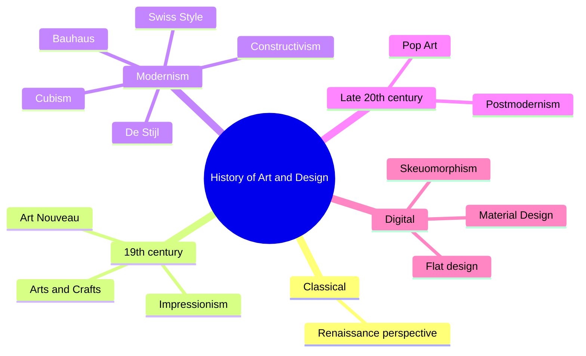

The course traces how art and design movements shaped today's visual language. It is your highest grade, so expect confident, specific answers.

### Outline

| Period / movement | Time | Key ideas | Names to remember |
| --- | --- | --- | --- |
| Renaissance | 14th–16th c. | Linear perspective, realism, humanism | Leonardo da Vinci, Michelangelo |
| Impressionism | 1860s–1880s | Light, colour, everyday scenes, visible brushstrokes | Claude Monet |
| Arts and Crafts | 1860s–1910s | Handcraft against mass production | William Morris |
| Art Nouveau | 1890–1910 | Organic curves, nature motifs, decorative posters | Alphonse Mucha |
| Cubism | 1907–1920s | Many viewpoints at once, geometric forms | Pablo Picasso, Georges Braque |
| Constructivism | 1910s–1930s | Art for society, bold geometry, propaganda posters | El Lissitzky, Rodchenko |
| De Stijl | 1917–1931 | Primary colours, straight lines, grids | Piet Mondrian |
| Bauhaus | 1919–1933 | Form follows function, art + industry, simple geometry | Walter Gropius |
| Swiss / International Typographic Style | 1950s–1960s | Grid, sans-serif (Helvetica), objectivity | Josef Müller-Brockmann |
| Pop Art | 1950s–1960s | Mass culture, bright colours, repetition | Andy Warhol |
| Postmodernism | 1970s–1990s | Breaking rules, layered, expressive type | David Carson |
| Digital design | 1980s–now | Skeuomorphism → flat design → Material, motion, responsive | Apple iOS 7 (2013), Google Material (2014) |

Link to your field:

- Bauhaus and Swiss Style → modern UI: grids, sans-serif type, minimal decoration, function first
- De Stijl → modular layouts and bold colour blocks
- Art Nouveau and Pop Art → expressive branding and posters

### Mind map

### Interview questions

1. Which movement influenced modern UI design most? Why?
   - Bauhaus and Swiss Style: function first, grids, clean sans-serif type. Example: most app interfaces today.
2. What does "form follows function" mean?
   - Design should start from purpose; decoration should not block use.
3. Compare Art Nouveau and Bauhaus.
   - Decorative organic curves vs functional geometric simplicity.
4. What is the Swiss Style?
   - Grid-based, asymmetric layouts, sans-serif type, objective photography.
5. What is the difference between skeuomorphism and flat design?
   - Imitating real materials (leather, shadows) vs simple shapes and colour; iOS 7 shift.
6. Which designer or movement inspires you and how does it show in your work?
   - Prepare one personal, specific answer linked to your graduation project.
