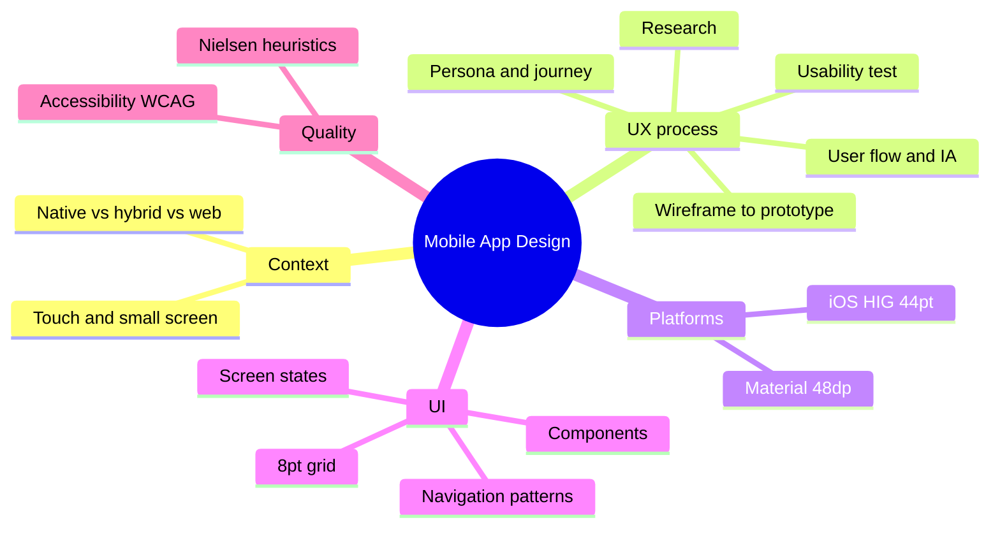

The course covers how to design a mobile app from user research to a tested, platform-correct prototype.

### Outline

1. Mobile context
   - Small screen, touch input, one-handed use, interruptions, variable network
   - Native, hybrid, and web apps; iOS vs Android market and conventions
2. UX process (user-centred design)
   - Research: interviews, surveys, competitor analysis
   - Define: personas, user journey map, problem statement
   - Ideate: user flow, information architecture (IA), sitemap
   - Design: sketch → low-fidelity wireframe → high-fidelity mockup → interactive prototype
   - Test: usability testing, iterate
3. Platform guidelines
   - Apple Human Interface Guidelines (HIG): tab bar, navigation bar, SF font, 44×44 pt touch target
   - Google Material Design 3: bottom navigation, app bar, FAB, Roboto, 48×48 dp touch target
   - Units: pt (iOS), dp (Android) are density-independent; px depends on screen density
4. UI building blocks
   - Navigation patterns: tab bar, drawer (hamburger), stack/hierarchical, gestures
   - Components: buttons, cards, lists, forms, modals, toasts
   - Screen states: empty, loading, error, success
   - Grid and spacing: 8-point grid, safe areas, thumb zone
5. Visual design
   - Hierarchy, contrast, colour system, typography scale, iconography
   - Accessibility: WCAG contrast 4.5:1 for normal text, Dynamic Type, screen readers
6. Evaluation
   - Nielsen's 10 usability heuristics
   - Usability test: tasks, success rate, time on task, think-aloud
7. Tools and handoff
   - Figma (components, auto layout, prototyping), design system, developer handoff

### Mind map

### Key terms

| Term | Meaning |
| --- | --- |
| Persona | A fictional user profile based on research data |
| User flow | The path of screens a user takes to finish one task |
| Wireframe | Low-fidelity layout showing structure, no visual style |
| Prototype | Clickable simulation used for testing |
| Affordance | A property that suggests how an object can be used |
| Thumb zone | Screen area easy to reach with one thumb |
| Design system | Shared library of components, styles and rules |

### Interview questions

1. What is the difference between UI and UX?
   - UX = the whole experience and how easy it is to reach a goal; UI = the visual and interactive surface. Example: a beautiful screen with a confusing flow has good UI but bad UX.
2. Describe your design process for a mobile app.
   - Research → define → ideate → design → test, then iterate. Name one app you designed in this course.
3. What is the difference between a wireframe, a mockup and a prototype?
   - Fidelity and interactivity: structure only → full visual → clickable.
4. How do iOS and Android design differ?
   - Navigation placement, back behaviour (Android system back), fonts, units (pt vs dp), touch target sizes.
5. Why do touch targets need a minimum size?
   - Fingers are imprecise; small targets cause errors. 44 pt on iOS, 48 dp on Android.
6. Name three of Nielsen's heuristics and give an example.
   - Visibility of system status (loading indicator), error prevention (confirm before delete), consistency and standards.
7. How do you test usability?
   - 5 users, realistic tasks, observe, think-aloud, measure success and time, fix the biggest problems first.
8. How do you make an app accessible?
   - Contrast 4.5:1, scalable text, labels for screen readers, not relying on colour alone.
