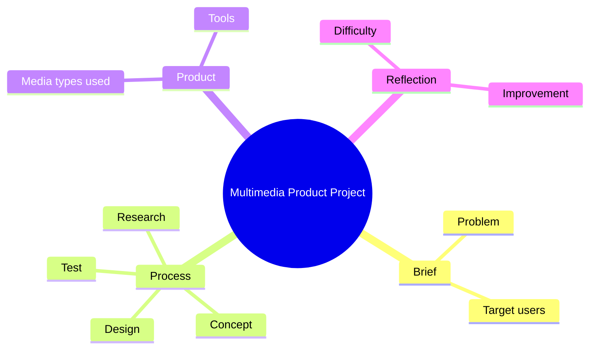

This is a project you made, so answers must come from your real work. Fill in every \[bracket\].

### 1-minute pitch

> "In this project, I designed \[product type, e.g. a mobile app / e-magazine / promo video\] called \[name\] for \[target users\]. The problem was \[problem\]. I worked \[alone / in a team of N\] and my role was \[role\]. I followed \[process: research → concept → design → test\]. I used \[tools\]. The result was \[output\], and the main thing I learned was \[lesson\]."

### Framework to prepare

| Part | Your answer |
| --- | --- |
| Product name and type | \[ \] |
| Target users | \[ \] |
| Problem / goal | \[ \] |
| Team size and your role | \[ \] |
| Process steps | \[ \] |
| Tools | \[ \] |
| Final output | \[ \] |
| Biggest difficulty and solution | \[ \] |
| What you would improve | \[ \] |

### Mind map

### Key concepts to connect

- Multimedia elements: text, image, audio, video, animation, interactivity
- Project phases: pre-production → production → post-production → delivery
- Double Diamond: discover → define → develop → deliver

### Interview questions

1. What did you make in this project and for whom?
2. Which multimedia elements did you combine and why?
3. What was your role in the team?
4. What was the hardest part and how did you solve it?
5. If you did it again, what would you change?
