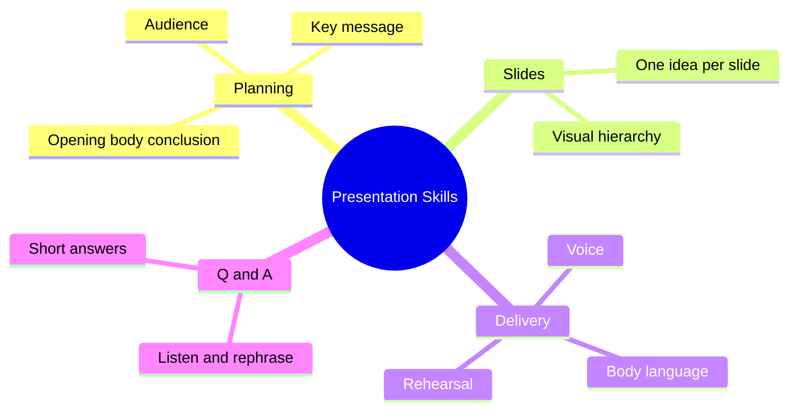

The course covers how to plan, design and deliver a clear presentation. Use it directly in the APS interview.

### Outline

1. Planning
   - Know the audience and the goal; one key message
   - Structure: opening (hook) → body (3 main points) → conclusion (summary + call to action)
2. Slide design
   - One idea per slide, large type, few words, strong visuals
   - Visual hierarchy, contrast, consistent template
3. Delivery
   - Voice: pace, volume, pauses; body language: eye contact, posture, gestures
   - Managing nervousness: rehearsal, breathing
4. Q&A
   - Listen fully, repeat or rephrase the question, answer briefly, admit what you don't know

### Mind map

### Interview questions

1. What makes a presentation effective?
   - Clear message, structure, audience focus, simple slides, confident delivery.
2. How do you design good slides?
   - One idea per slide, minimal text, consistent visual style.
3. How do you handle a question you cannot answer?
   - Be honest, give what you know, offer to follow up.
