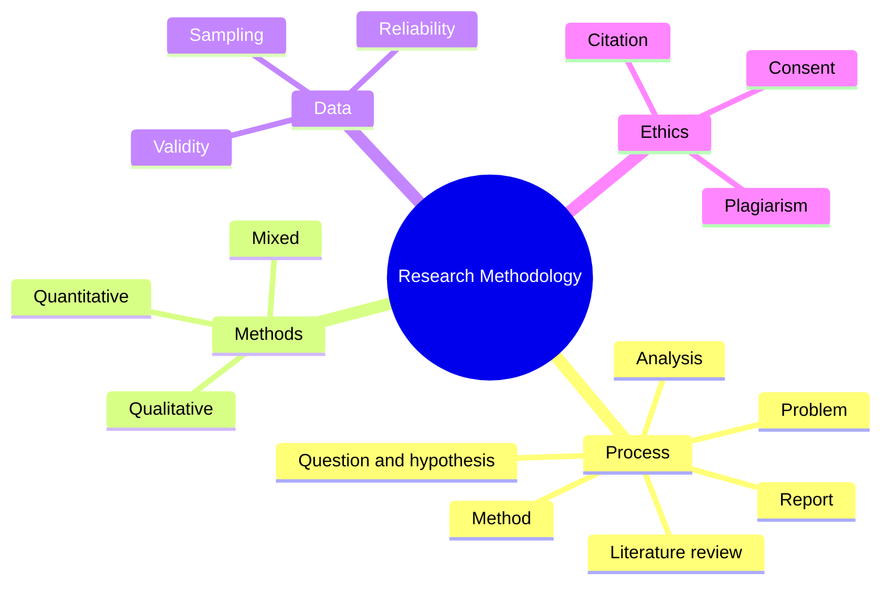

The course covers how to plan and carry out a research study, from the question to the written report.

### Outline

1. Research basics
   - Science vs opinion; basic vs applied research
   - Research process: topic → problem → literature review → question/hypothesis → method → data collection → analysis → conclusion → report
2. Research question and hypothesis
   - Good question: specific, measurable, feasible, relevant
   - Hypothesis: a testable prediction
   - Variables: independent, dependent, control
3. Literature review
   - Finding sources (Google Scholar, journals), evaluating them, identifying the research gap
4. Methods
   - Quantitative: surveys, experiments, statistics (numbers, large samples)
   - Qualitative: interviews, observation, focus groups, case studies (meaning, small samples)
   - Mixed methods
   - In design research: user interviews, usability tests, A/B tests
5. Sampling and data
   - Population vs sample; random vs convenience sampling
   - Validity (measures what it should) and reliability (consistent results)
6. Analysis and reporting
   - Descriptive statistics, thematic analysis
   - Report structure: introduction, literature review, method, results, discussion, conclusion, references
7. Research ethics
   - Informed consent, anonymity, honest reporting
   - Citation styles (APA, IEEE); avoiding plagiarism

### Mind map

### Key terms

| Term | Meaning |
| --- | --- |
| Research gap | A question existing studies have not answered |
| Hypothesis | A testable prediction |
| Validity | Whether a method measures what it claims to |
| Reliability | Whether results are consistent when repeated |
| Sample | The group studied from a larger population |
| Plagiarism | Using others' work without credit |

### Interview questions

1. What are the steps of a research process?
2. What is the difference between quantitative and qualitative research? Give a design example.
   - Survey of 200 users rating an app (quantitative) vs 5 in-depth interviews (qualitative).
3. What makes a good research question?
4. What is the difference between validity and reliability?
5. Did you use research in your graduation project? How?
   - Name the method, number of participants, and one finding that changed your design.
