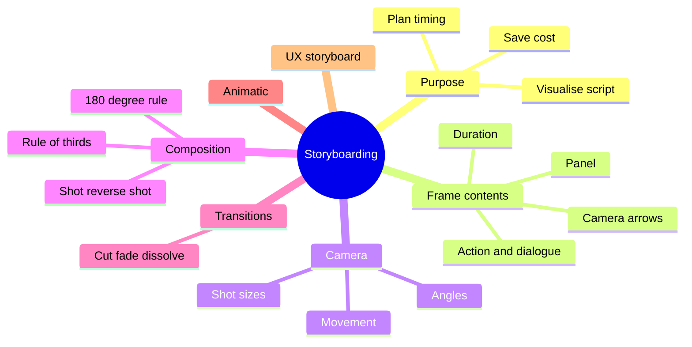

The course covers how to plan a film, animation or ad visually, shot by shot, before production.

### Outline

1. Purpose of a storyboard
   - Visualise the script, plan camera and timing, save production cost, communicate with the team
   - Pipeline: idea → script → storyboard → animatic → production
2. Storyboard frame contents
   - Panel drawing, shot number, action description, dialogue/sound, camera movement arrows, duration
3. Shot sizes
   - Extreme wide / establishing shot, wide (long) shot, medium shot, close-up, extreme close-up
4. Camera angles and movement
   - Eye level, high angle (subject looks weak), low angle (subject looks powerful), bird's-eye, Dutch angle
   - Pan, tilt, zoom, dolly/track, crane
5. Composition and continuity
   - Rule of thirds, leading lines, framing, depth
   - 180-degree rule, eyeline match, match cut, shot/reverse shot
6. Transitions
   - Cut, fade, dissolve, wipe
7. Animatic
   - Storyboard panels timed with sound to test pacing
8. Storyboards in UX
   - Drawing a user's situation as comic panels to show context and need

### Mind map

### Key terms

| Term | Meaning |
| --- | --- |
| Establishing shot | Wide shot that shows where the scene happens |
| 180-degree rule | Camera stays on one side of the action line so direction stays consistent |
| Animatic | Timed storyboard with sound |
| Pan / tilt | Camera turns horizontally / vertically |
| Dolly | Camera physically moves toward or away |
| Shot list | Table of every shot to film |

### Interview questions

1. Why is a storyboard needed before production?
   - Finds problems early, aligns the team, estimates time and budget.
2. Name the main shot sizes and when you use them.
   - Wide to set location, medium for action and dialogue, close-up for emotion.
3. What is the 180-degree rule?
   - Imaginary line between characters; crossing it flips screen direction and confuses viewers.
4. What is the difference between a storyboard and an animatic?
   - Static panels vs timed sequence with sound.
5. How does a low-angle shot affect the viewer?
   - The subject looks bigger and more powerful.
6. Tell me about a storyboard you made.
   - Story, number of shots, a camera choice you made and why.
