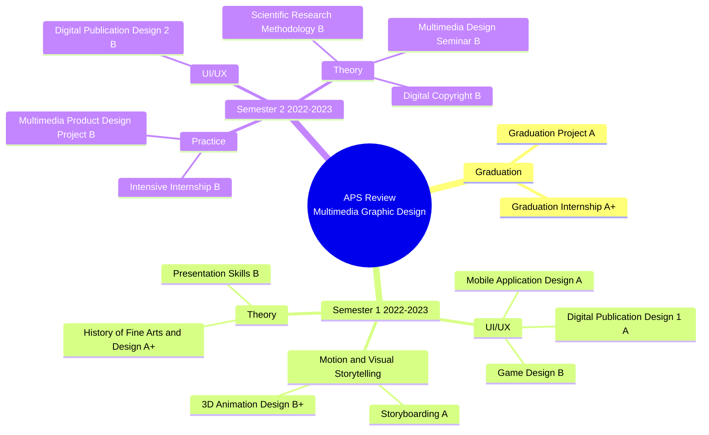

## Cách dùng tài liệu và lộ trình 14 ngày

Tài liệu bao gồm 13 môn của 2 kỳ cuối (năm học 2022–2023) cùng Đồ án và Thực tập tốt nghiệp. Mỗi môn có 5 phần: đề cương, mind map, thuật ngữ cần nói được bằng tiếng Anh, câu hỏi phỏng vấn kèm ý trả lời, và tài liệu tham khảo. Phần nội dung môn học được viết bằng tiếng Anh để bạn luyện nói đúng thuật ngữ khi phỏng vấn.

Các phần liên quan đến **đồ án và thực tập** đang để khung trống. Bạn cần tự điền nội dung thật của mình, vì đây là nhóm câu hỏi chắc chắn sẽ được hỏi sâu nhất.

| Ngày | Nội dung | Kết quả cần có |
| --- | --- | --- |
| 1–2 | Đồ án tốt nghiệp + Thực tập tốt nghiệp | Bài nói 2 phút, trả lời trôi chảy 15 câu hỏi |
| 3 | Đồ án thiết kế SP ĐPT + Thực tập chuyên sâu | Bài nói 1 phút cho mỗi mục |
| 4 | Mobile Application Design | Vẽ lại mind map, giải thích quy trình UX |
| 5 | Digital Publication Design 1 và 2 | So sánh in và số, fixed và reflowable layout |
| 6 | Game Design | Giải thích MDA, core loop, flow |
| 7 | Storyboarding + 3D Animation Design | Kể lại 3D pipeline và các cỡ cảnh |
| 8 | History of Fine Arts and Design | Dòng thời gian các trào lưu, liên hệ với UI |
| 9 | Scientific Research Methodology + Digital Copyright | Định nghĩa rõ ràng, có ví dụ |
| 10 | Seminar + Presentation Skills, ôn toàn bộ mind map | Tự nói 1 phút cho mỗi môn |
| 11 | Làm bài kiểm tra trắc nghiệm | Đạt ≥ 80% |
| 12–13 | Phỏng vấn thử với Claude | 2 buổi, mỗi buổi 20 phút |
| 14 | Ôn lại những câu trả lời sai | Ổn định, tự tin |

## Chiến lược trả lời phỏng vấn

Với mỗi câu hỏi, hãy trả lời theo khung **D-E-A**, gói gọn trong 30–60 giây:

1. **Define** (định nghĩa): nói khái niệm trong 1 câu.
2. **Explain** (giải thích): nêu 2–3 ý chính hoặc các bước.
3. **Apply** (áp dụng): đưa ví dụ từ đồ án hoặc bài tập của chính bạn.

Mẫu câu tiếng Anh nên dùng:

- "In this course, we learned how to…"
- "The main idea of X is…"
- "For example, in my graduation project, I…"
- "There are three main steps / types: first…, second…, finally…"
- "The difference between A and B is that…"
- Khi chưa nghe rõ: "Could you please repeat the question?"
- Khi không nhớ chi tiết: "I don't remember the exact detail, but the main principle is…"

Những điều cần tránh:

- Học thuộc lòng nguyên văn. Người hỏi sẽ đào sâu bằng "why" và "how".
- Nói sai tên phần mềm hoặc công cụ bạn đã dùng.
- Để im lặng quá lâu. Nếu cần, hãy nói định nghĩa trước rồi nghĩ tiếp.

## Mind map tổng quan

Toàn bộ phạm vi ôn tập xoay quanh **sản phẩm của bạn**. Các môn lý thuyết là phần nền để giải thích vì sao bạn chọn cách làm đó trong đồ án.

